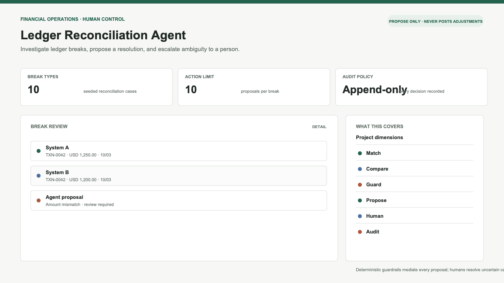
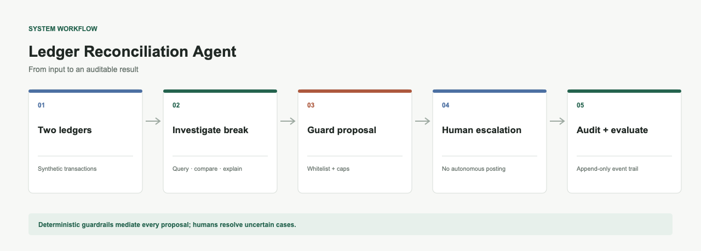

# Ledger Reconciliation Agent

**Finds payment breaks and explains what it did.**

An LLM agent over synthetic ledger data that matches transactions across two systems which disagree, proposes fixes for the breaks, and escalates anything it isn't sure about with its reasoning attached. It can query, compare and propose. It can't write. Every state change goes through a deterministic guardrail and lands in an append-only audit log.

No risk function on earth is going to let a language model post an adjustment on its own authority. Any design that assumes otherwise is a demo that will never leave the sandbox.





## Quick Start

```bash
pip install -e ".[dev]"
export OPENAI_API_KEY="sk-..."
ledger-rec generate
ledger-rec reconcile
ledger-rec evaluate
```

## How It Works

```
System A (Ledger)          System B (Ledger)
      │                          │
      └──────────┬───────────────┘
                 │
          ┌──────▼──────┐
          │  AGENT LOOP  │
          │  (LLM)       │
          │              │
          │  • Investigate│
          │  • Compare   │
          │  • Propose   │
          │  • Escalate  │
          └──────┬──────┘
                 │
          ┌──────▼──────┐
          │  GUARDRAIL   │ ← Every proposal passes through here
          │  (deterministic)
          └──────┬──────┘
                 │
     ┌───────────┼───────────┐
     │           │           │
 ┌───▼───┐  ┌───▼───┐  ┌───▼───┐
 │Audit  │  │Match  │  │Escalate│
 │Log    │  │Proposal│  │Queue   │
 │(append│  │        │  │(human) │
 │ only) │  │        │  │        │
 └───────┘  └───────┘  └────────┘
```

## Break Types

| Type | Description | Agent Strategy |
|------|-------------|---------------|
| `amount_mismatch` | Same reference, different amounts | Compare amounts, propose smaller |
| `missing_side_a` | Transaction only in System B | Flag for investigation |
| `missing_side_b` | Transaction only in System A | Flag for investigation |
| `duplicate` | Same transaction appears twice | Deduplicate, keep one |
| `date_shift` | Same transaction, different dates | Use earlier date (T+2 settlement) |
| `currency_mismatch` | Different currencies | Normalize to base, check FX |
| `reference_typo` | Typo in reference ID | Fuzzy match references |
| `swapped_counterparty` | Different counterparties | Use System A as source of truth |
| `reversed_sign` | Positive in one, negative in other | Use absolute value |
| `fee_discrepancy` | Different fee amounts | Flag for review |

## Usage

### Generate synthetic ledgers

```bash
ledger-rec generate --transactions 5000 --break-rate 0.15
```

Creates two Parquet files (System A, System B) and a ground truth JSON.

### Run the agent

```bash
ledger-rec reconcile --model gpt-4o --max-steps 15 --max-cost 0.50
```

Runs the agent against every break, produces results, audit log, and escalation queue.

### Evaluate accuracy

```bash
ledger-rec evaluate --results results/results.json --ground-truth data/synthetic/ground_truth.json
```

Computes resolution rate, false resolution rate, escalation rate, cost per break, and audit integrity.

### Query ledgers directly

```bash
ledger-rec query --reference "TXN-00000042"
ledger-rec query --counterparty "ACME"
ledger-rec query --min-amount 1000 --max-amount 5000
```

### Start the API server

```bash
ledger-rec serve --port 8000
```

## API Endpoints

| Endpoint | Method | Description |
|----------|--------|-------------|
| `/health` | GET | Health check |
| `/generate` | POST | Generate synthetic ledgers |
| `/stats` | GET | Ledger statistics |
| `/reconcile` | POST | Reconcile a single break |
| `/escalations` | GET | List pending escalations |
| `/escalations/resolve` | POST | Resolve/dismiss escalation |
| `/audit` | GET | View audit log |
| `/audit/integrity` | GET | Verify audit chain integrity |

## Guardrails

Every agent action passes through a deterministic guardrail:

- **Action whitelist**: Only 16 allowed actions (query, compare, propose, escalate)
- **Forbidden patterns**: Blocks SQL injection, shell commands, path traversal
- **Proposal limits**: Maximum 10 proposals per break
- **Confidence threshold**: Match proposals require confidence ≥ 0.5
- **Amount caps**: Adjustments limited to $1M

## Evaluation Criteria

The agent is measured against:

| Metric | Target |
|--------|--------|
| Break resolution accuracy | ≥ 80% |
| False resolution rate | ≤ 5% |
| Escalation rate | ≤ 30% |
| Mean steps per break | ≤ 10 |
| Audit trail completeness | 100% |
| Unlogged state changes | 0 |

## Project Structure

```
├── src/ledger_rec/
│   ├── cli.py                    # CLI entry point
│   ├── ledger/generator.py       # Synthetic ledger generator (10 break types)
│   ├── tools/suite.py            # Query, fuzzy match, FX, date, proposal tools
│   ├── agent/loop.py             # LLM agent loop with step/budget caps
│   ├── guardrails/engine.py      # Deterministic guardrail
│   ├── audit/log.py              # Immutable append-only audit log
│   ├── escalation/queue.py       # Human escalation queue
│   ├── api/server.py             # FastAPI server
│   └── eval/metrics.py           # Accuracy evaluation
├── config/default.json           # Configuration
├── docker/                       # Docker setup
├── tests/                        # Unit + integration tests
└── README.md
```

## License

MIT
